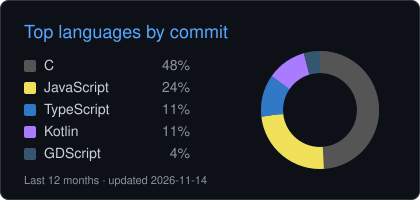

# Oi, eu sou o Coimbrice! 

<table align="right">
  <tr><td><a href="https://github.com/Coimbrice/Coimbrice/blob/main/README.md">English</a></td></tr>
  <tr><td><a href="https://github.com/Coimbrice/Coimbrice/blob/main/README.pt-BR.md">Português</a></td></tr>
</table>

Sou o Luís, desenvolvedor fullstack de **Manaus, AM**, morando atualmente em **Limeira, SP**.

Sou bacharel em Sistemas de Informação pela UEA (Universidade do Estado do Amazonas). Meu TCC foi um monitor de exercícios fisioterapêuticos que usa visão computacional e um autoencoder LSTM para dizer, em tempo real, se o exercício está sendo feito do jeito certo. Depois ele virou um [artigo publicado no SBCUP 2024](https://doi.org/10.5753/sbcup.2024.2662).

### Com o que eu programo

### Projetos open source

- [**quina-ds**](https://github.com/Coimbrice/quina-ds): jogo de adivinhar palavras em português que roda num Nintendo DS de verdade. *C, BlocksDS.*
- [**bolus-pra-bolos**](https://github.com/Coimbrice/bolus-pra-bolos): biblioteca em TypeScript para calcular doses de insulina, baseada no livro *Think Like a Pancreas*. *TypeScript.*
- [**OddOne**](https://github.com/Coimbrice/OddOne): jogo presencial de dedução social para jogar em grupo pelo celular. *JavaScript.*

### Linguagens mais usadas

  
  

### Onde me encontrar

---

  O card de linguagens é gerado de novo todo dia por uma <a href="https://github.com/Coimbrice/Coimbrice/actions/workflows/profile.yml">GitHub Action</a>.
   
  

